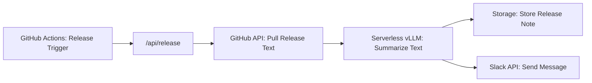

# Runpod Demo

This application can send release note notifications to slack, and create release notes for documentation. GitHub Actions can call the application when a new release is created, and a Slack notification is automatically sent to a Slack channel. This way people in the organization can stay updated on software releases. 

The application also provides an endpoint that lists release notes, this endpoint can be used for documentation or other purposes. The frontend of this application is a simple web page that shows the release notes. 


## Runpod Services
The application is built using three Runpod services: [Serverless](https://docs.runpod.io/serverless/overview), [Pod](https://docs.runpod.io/pods/overview) and [Storage](https://docs.runpod.io/storage/overview).

* **Serverless**: The application uses an LLM to summarize release notes, and organize the text as bullet points. Using vLLM workers deployed as a Serverless endpoint is a convenient and easily customizable way to use LLM models.
* **Pod**: The application backend is deployed to a Pod, an affordable and scalable way to host the backend.
* **Storage**: The release notes could be stored in a database, but for the sake of simplicity, they are stored in a CSV file. Using the Storage service it's easy for the backend to write to the file, and to read the file for the frontend endpoint.

## Architecture


The core functionality is built as a Python application. The `main.py` file is the application entry point and defines the two API endpoints `/api/release` and `/api/releases`. The functionality for fetching release notes from GitHub, summarizing release notes, sending Slack messages etc. are separated out into individual files. 

```text
runpod-demo/
├── main.py             # FastAPI app and endpoints 
├── github.py           # GitHub release notes fetching
├── summarize.py.       # RunPod LLM summarization
├── slack.py            # Slack notification
├── request_log.py.     # CSV request log on RunPod S3 storage
├── requirements.txt.   # Python dependencies
└── .env                # Template for the `.env` settings file
```
### Environment Variables
The application configuration is stored in the `.env` file, which stores configurations for the Serverless vLLM endpoint, the file storage and the Slack integration.

```ini
# RunPod serverless vLLM endpoint (summarization)
RUNPOD_API_KEY=rpa_...
RUNPOD_ENDPOINT_ID=...
RUNPOD_MODEL=...
```

```ini
# RunPod network volume via its S3-compatible API (request log)
RUNPOD_S3_ACCESS_KEY=user_...
RUNPOD_S3_SECRET_KEY=rps_...
RUNPOD_S3_ENDPOINT=...
RUNPOD_S3_REGION=...
RUNPOD_S3_BUCKET=...
```

```ini
# Optional: browser origins allowed to call GET /api/releases (comma-separated, no trailing slash).
CORS_ORIGINS=https://POD_ID-80.proxy.runpod.net
```

```ini
# Slack (bot needs the chat:write scope and must be invited to the channel)
SLACK_BOT_TOKEN=xoxb-...      # Must use the Bot User OAuth Token (xoxb-...)
SLACK_CHANNEL=#runpod         # Choose the channel, the Slack App Bot must be added
```

When the application is deployed to either Runpod Serverless or Pod, the environment variables are set in the Serverless or Pod settings.


## Deployment
The frontend, backend and LLM are deployed on Runpod. The frontend and backend are both deployed in Pods and the LLM is deployed as a Serverless endpoint. 

### Deploy vLLM
The application summarizes the release notes fetched from GitHub using an LLM. The LLM is deployed as a Serverless endpoint, using vLLM.

1. In the RunPod console, open **Serverless -> New endpoint**
2. Choose **Deploy LLM API** and then pick an LLM and click **Deploy with vLLM**
3. Click **Next** (no advanced settings are necessary)
4. Select GPU configuration and click **Create Endpoint**

Click the new vLLM endpoint and get the **Endpoint ID** and **Model** for the environment variables. 

### Deploy the Backend
The backend is deployed in a Runpod Pod 

1. In the RunPod console, open **Pods -> Deploy** and pick a worker type (the app doesn't use a GPU, so the cheapest option is fine).
2. Click **Edit Pod** and set:
   - **Container image:** `YOUR_DOCKER_USERNAME/release-backend:v1` (add registry credentials in settings if the image is private).
   - **Expose HTTP Ports:** `80`.
   - **Environment variables:** `PORT=80` plus every setting from the Architecture section. Also set (Runpod) `API_KEY` and `SUMMARIZE_TIMEOUT_SECONDS=100`.
   - Leave the container start command empty; the image already runs uvicorn on `$PORT`.
3. Deploy. The service is then available at `https://POD_ID-80.proxy.runpod.net`.

### Deploy the Frontend
The frontend is deployed in a Runpod Pod 

1. In the RunPod console, open **Pods -> Deploy** and pick a worker type (the app doesn't use a GPU, so the cheapest option is fine).
2. Click **Edit Pod** and set:
   - **Container image:** `YOUR_DOCKER_USERNAME/release-frontend:v1` (add registry credentials in settings if the image is private).
   - **Expose HTTP Ports:** `80`.
   - **Environment variables:** `PORT=8100` and `API_URL=https://POD_ID-80.proxy.runpod.net/api/releases`. Also set (Runpod) `API_KEY`.
   - Leave the container start command empty; the image already runs uvicorn on `$PORT`.
3. Deploy. The service is then available at `https://POD_ID-80.proxy.runpod.net`.


## Usage


```bash
curl https://POD_ID-8100.proxy.runpod.net/api/alive

curl -X POST https://POD_ID-8100.proxy.runpod.net/api/release \
  -H "X-API-Key: $API_KEY" -H "Content-Type: application/json" \
  -d '{"owner": "runpod", "repo": "containers", "html_url": "https://github.com/runpod/containers/releases/tag/comfyui-v1.4.1"}'
```


## Challenges
There are a couple of unresolved issues with the application. 

1. Troubleshooting is hard
2. Cloudflare timeout (Pods)
3. Hard to find the right model


## Learnings
Runpod is well-documented, but as a new developer using Runpod, there are unanswered questions along the way. After some trial-and-error I went back to the documentation, and then parts of it made more sense. 

The backend was initially deployed Serverless, but after long struggles to make it work, the backend was deployed to a Pod instead. 


### What would I change?
This was my first time using Runpod and deploying an application, so I had no prior experience to lean on, and experienced Runpod as any other developer deploying their first application. Some of the things that would had made my journey more smooth would be:

1. **Tutorials**: Teach developers new to Runpod core concepts and how to deploy their first endpoints, Pods, storage volumes etc. Focus should not only be on how to do it, but also learning how to make the right decisions when you build and deploy on Runpod.
2. **Guides**: Step-by-step guides that show how to use Runpod for different use cases, and how to build for scale. The guides assume the developer has at least basic knowledge about Runpod (maybe acquired from the tutorials), and now they want to use Runpod for their production application.
3. **Video Content**: Video walk-through by team members (DevRel, Engineering) using Runpod. Can be from building a simple application and deploying it, to deep-dives in specific features. To follow along when someone experienced use Runpod can be very educational and helpful.

The good thing is, there's a lot of information in the documentation. It's just organized more for looking up information rather than educating developers. 

> [!WARNING]
> **Use at your own risk.** This software is provided "as is," without warranty of any kind. The authors are not responsible for any damage, data loss, or system instability caused by using this repository.
> 
_2026, Carsten Jacobsen_


